  

---

## 🚀 Featured Projects

### 🩸 BloodGuard

**Access control system for a hospital blood bank**, combining a Spring Boot REST API, JWT-based authentication, an optional physical card reader (ESP32 + RFID), and AI-assisted anomaly detection on access logs.

🔗 **[View Project](https://github.com/Ricardo0706/BloodGuard)**

---

## 🎯 Currently

🔭 Building backend projects with **Java & Spring Boot** 
🌱 Deepening my knowledge of **software architecture, databases and system design** 
📚 Studying **Computer Science & Engineering at ITMO University** 
💼 Open to **Internship & Junior Backend Developer opportunities**

---

## 📫 Connect With Me

---

  <i>Building reliable software. Learning continuously. 🚀</i>

